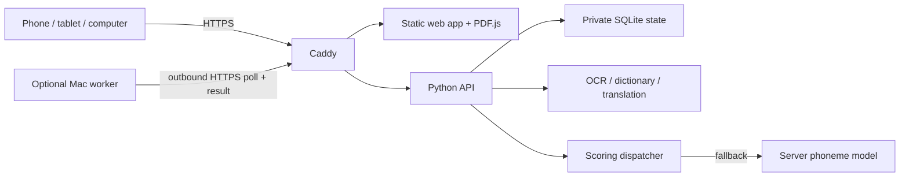

<div align="center">

# RAZ Reader — Open-source RAZ Reading & Pronunciation Practice

**Read RAZ-style graded books. Listen, practice, and track your progress.**

Self-hosted graded reading · Personal progress · Offline speech models · Optional Mac acceleration

[**Live Demo**](https://raz.aotefan.com) · [English](README.md) · [简体中文](README.zh-CN.md)

[](https://github.com/aotefan/raz-reader/actions/workflows/ci.yml)
[](LICENSE)

</div>

RAZ Reader is an **unofficial, open-source RAZ reading app** for English learners. It turns **your own PDF books** into a graded reading library that works on phones, tablets, and computers. Read a page, listen to its available narration, look up a word, and record yourself for pronunciation feedback. A compact interface keeps the book in focus.

**Try it online:** [raz.aotefan.com](https://raz.aotefan.com) — open the hosted reader in your phone, tablet, or desktop browser without installing anything.

**This repository contains application source code, not a RAZ book collection.** No commercial books, book audio, user recordings, account databases, model weights, production configuration, or API credentials are included. The screenshots below use original example stories and vector artwork generated by this project.


## A closer look

<table>
  <tr>
    <td align="center"><br><strong>Focus on the page</strong><br>A compact reading and practice toolbar.</td>
    <td align="center"><br><strong>Choose a level</strong><br>A touch-friendly bottom sheet.</td>
  </tr>
</table>

These are captures of the running application, not design mockups. The current application UI is primarily **Simplified Chinese**, for English learners; documentation is available in English and Chinese. Full English UI localization is not yet implemented.

## What it does

- **Read your own books.** PDF.js renders the original PDF, including text layers and supported embedded audio. Pinch to zoom; resume where you left off.
- **Keep a simple bookshelf.** Search, filter by grade or reading status, remember the selected level, and put unfinished books before completed books.
- **Keep readers separate.** In HTTPS/cloud mode, use usernames, passwords and nicknames, switch between up to eight remembered accounts, and synchronize each account's progress across devices.
- **Understand a page.** English-to-Chinese translation, ECDICT word lookup, single-word pronunciation, and OCR for image-only pages use self-hosted tools.
- **Practice pronunciation.** Save the latest recording per page and compare recognized phonemes with the target text. View word-level feedback and expected/heard sounds.
- **Use a Mac when available.** An optional Mac worker pulls scoring jobs over HTTPS. An unavailable, busy or timed-out worker falls back to the server's scorer.

Narration requires audio already embedded in a book or a verified audio mapping. Having an audiobook does not automatically provide accurate page or sentence timing. Commercial encouragement voice files from the private deployment are omitted; visual rewards still work.

## Try the original demo

The demo generates six small, original books locally. One includes locally generated test narration. It does not scan another directory, download books, or contact the author's deployment.

### Prerequisites

Python 3.9+ and Poppler, qpdf, FFmpeg. Optional speech/translation environments require **Python 3.11**. Node is only needed for browser tests, not for serving the app.

**macOS** (with Homebrew installed):

```bash
brew install python@3.11 poppler qpdf ffmpeg tesseract espeak-ng
```

**Ubuntu/Debian**:

```bash
sudo apt-get update
sudo apt-get install python3 python3-venv poppler-utils qpdf ffmpeg espeak-ng tesseract-ocr tesseract-ocr-eng
```

### Start

```bash
git clone https://github.com/aotefan/raz-reader.git
cd raz-reader
./scripts/bootstrap.sh
./scripts/start.sh
```

Open **http://127.0.0.1:8765**. Stop with `Ctrl+C`. To select another port: `RAZ_PORT=8875 ./scripts/start.sh`.

The default service is local-only and uses one local reading profile. Multi-account login and cross-device synchronization require HTTPS/cloud mode; see [deployment](docs/DEPLOYMENT.md). Microphone access requires localhost or a secure HTTPS context and a supported browser.

### Optional language and scoring tools

```bash
# Dictionary + English-to-Chinese translation
./scripts/setup_language.sh

# Pronunciation scoring — substantial model/dependency download
./scripts/setup_assessment.sh
```

Install these only when you need them, then restart the reader. Model installers pin upstream versions/revisions and store downloads in ignored `data/` directories. Initial installation needs the internet; normal model inference runs locally. Reading works without these optional models; unavailable tools report that they are not installed.

The scorer uses a CPU phoneme model, not a paid speech API. Long recordings and concurrent requests can be slow on small servers. The UI limits takes to 10–55 seconds according to page length; the engine accepts at most 60 seconds and 120 reference words.

## Bring your own library

Organize material you are entitled to use in grade directories:

```text
library/
├── AA.PDF/
│   └── My first book.pdf
├── A.PDF/
│   └── Another story.pdf
└── B.PDF/
    └── ...
```

```bash
python3 scripts/import_library.py --root ./library
./scripts/start.sh
```

The importer replaces the active book manifest, retains existing private progress, and leaves source PDFs unchanged. It accepts an explicit library directory and does not upload it. Generated manifests contain local paths and must stay private. Restart after changing the manifest.

Standalone narration must have verified content and edition/page mappings; it is never attached by filename alone. The importer does not promise automatic alignment of an entire audio collection. Publishing a reading service is a separate action: only serve material you have permission to make available.

## How it works



| Component | Implementation |
| --- | --- |
| Frontend | Native HTML/CSS/JavaScript modules; Mozilla PDF.js |
| Backend | Python standard-library threaded HTTP server |
| State | SQLite for accounts, progress, latest recordings and assessment results |
| Pronunciation | OpenPronounce phoneme APIs + PyTorch CPU; project-specific weighted phoneme-edit score |
| Language tools | Tesseract, Poppler, ECDICT, CTranslate2/SentencePiece, eSpeak NG or macOS system voice |
| Hosting | Same-origin HTTPS reverse proxy; optional Mac worker managed by launchd |

Scoring compares the actual recognized sounds against the expected sounds in the page text. It is a **practice aid**, not a certified pronunciation exam or comprehension score. OCR errors can affect the reference sentence. The 80-point pass threshold and reward stars are presentation rules, not score inflation.

The Mac worker opens no inbound port and requires no shared Wi-Fi or public tunnel. It receives the current recording and reference text, computes a report, and returns it to the server. Recordings and results remain bound to an account and recording version. The server remains necessary for the website and data even when the Mac is online.

Read the [architecture](docs/ARCHITECTURE.md), [deployment guide](docs/DEPLOYMENT.md), and [security boundaries](SECURITY.md).

## Development

```bash
python3 -m unittest discover -s tests -p 'test_*.py' -v
npm ci --ignore-scripts
npx playwright install chromium
npm run test:e2e
python3 scripts/audit_public.py
```

On macOS with Google Chrome already installed, use `PW_CHANNEL=chrome npm run test:e2e` instead of downloading a browser. The browser suite exercises original books: bookshelf, search, PDF rendering, page persistence and the mobile picker. The backend suite covers account isolation, audio handling, version guards and scoring failover; many model-bound unit tests use controlled substitutes and do not establish real-world model accuracy.

| Directory | Purpose |
| --- | --- |
| `web/` | Reader, bookshelf, account center and vendored browser dependencies |
| `engine/` | API, private state, audio processing and assessment coordination |
| `scripts/` | Demo generation, explicit imports, optional model setup and Mac worker |
| `tests/` | Source-only regression tests using temporary/generated data |
| `docs/` | Architecture, deployment and reviewed example screenshots |
| `data/`, `library/`, `fixtures/generated/` | Local-only runtime/material directories; never committed |

See [CONTRIBUTING.md](CONTRIBUTING.md) before submitting screenshots, fixtures, or logs.

## Scope and license

This first public release is a self-hosted web app. An Android package, complete offline-book download manager, on-phone model inference, parent/child account hierarchy, and multi-server high availability are not included. The private deployment's Android shell, operational scripts and production settings were intentionally left out of the public source package.

Original application code and original example text/art are under [Apache-2.0](LICENSE). Third-party components retain their own licenses; the repository is **not a claim that every dependency is Apache-2.0**. See [THIRD_PARTY_NOTICES.md](THIRD_PARTY_NOTICES.md) and [UPSTREAM.json](UPSTREAM.json). Optional model weights, dictionaries and external tools have their own terms and are not bundled here.

RAZ Reader is an independent project. It is not affiliated with or endorsed by Learning A–Z, Raz-Kids, or Reading A–Z. No RAZ learning materials are distributed in this repository.
