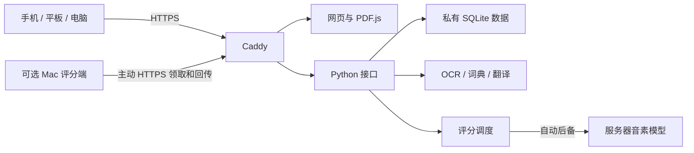

<div align="center">

# RAZ Reader · 开源 RAZ 分级阅读与跟读评分

**RAZ 绘本阅读、英语跟读评分、个人进度，一个网页完成。**

自建分级阅读 · 独立阅读进度 · 本地语音模型 · 可选 Mac 加速

[English](README.md) · [简体中文](README.zh-CN.md)

[](https://github.com/aotefan/raz-reader/actions/workflows/ci.yml)
[](LICENSE)

</div>

RAZ Reader 是一款开源的 **RAZ 分级阅读器与英语跟读评分工具**，把**你自己的 PDF 绘本**整理成一个手机、平板、电脑都能使用的阅读网站。支持 RAZ 绘本阅读、原声点读、中文翻译、录音评测、多账号切换和阅读进度同步，常用操作收在紧凑的工具栏里。本项目为非官方工具。

**这个仓库开源的是软件，不是 RAZ 资料包。** 不包含商业绘本、配套音频、用户录音、账号数据库、模型权重、线上部署配置或密钥。下面的截图全部来自项目自制的示例故事和矢量插图。


## 界面

<table>
  <tr>
    <td align="center"><br><strong>把空间留给绘本</strong><br>阅读与跟读功能集中在一行。</td>
    <td align="center"><br><strong>轻点选择等级</strong><br>适合触屏的底部选择面板。</td>
  </tr>
</table>

截图来自实际运行的软件，并非效果图。目前应用界面主要是简体中文，阅读内容为英文；项目说明提供英文与中文，完整英文界面尚未实现。

## 主要功能

- **阅读自己的绘本**：PDF.js 展示原 PDF，支持文字层、缩放和受支持的内嵌音频，重新打开接着上次读。
- **简洁书架**：按等级、状态和书名筛选，记住上次等级；未读完优先，读完的排到后面。
- **多人独立使用**：HTTPS 云端模式支持账号、密码和昵称，同一设备可记住最多 8 个账号并快速切换；同一账号跨设备同步。
- **理解当前页**：自建英文词典、英译中、单词发音；图片页自动 OCR，不用手动输入正文。
- **录音跟读**：每页保留最新录音，用真实音素识别做发音对照，查看单词与音标反馈。
- **可选 Mac 加速**：Mac 就绪时主动领取评分任务；离线、繁忙、中断或超时自动由服务器评分。

原声播放需要 PDF 自带音频或已经核验的音频映射，有整本 MP3 不代表已经完成每页、每句对齐。私人部署使用的鼓励配音未放入开源包，视觉星级反馈仍可使用。

## 本地体验

演示会在本机生成六本原创小绘本，其中一本带本机合成的测试朗读。不扫描其他目录，不下载绘本，不连接作者的线上站点。

### 安装基础工具

需要 Python 3.9+、Poppler、qpdf、FFmpeg。可选翻译与评测环境需要 **Python 3.11**。Node 只用于浏览器测试，网页服务本身不需要 Node。

**macOS**（先装好 Homebrew）：

```bash
brew install python@3.11 poppler qpdf ffmpeg tesseract espeak-ng
```

**Ubuntu / Debian**：

```bash
sudo apt-get update
sudo apt-get install python3 python3-venv poppler-utils qpdf ffmpeg espeak-ng tesseract-ocr tesseract-ocr-eng
```

### 启动

```bash
git clone https://github.com/aotefan/raz-reader.git
cd raz-reader
./scripts/bootstrap.sh
./scripts/start.sh
```

打开 **http://127.0.0.1:8765**；终端按 `Ctrl+C` 停止。更换端口可用 `RAZ_PORT=8875 ./scripts/start.sh`。

默认只监听本机，使用一份本地阅读记录。账号登录与多设备同步需要配置 HTTPS 云端模式，详见 [部署说明](docs/DEPLOYMENT.zh-CN.md)。录音需要浏览器支持麦克风，并通过 localhost 或 HTTPS 访问。

### 按需安装翻译与评分

```bash
# 英文词典与英译中
./scripts/setup_language.sh

# 发音评分：需要下载较大的模型和依赖
./scripts/setup_assessment.sh
```

安装后重启阅读服务。模型和词库保存在 Git 忽略的 `data/` 中，首次安装需要联网，日常模型计算在自建服务本地完成。没有安装可选模型时仍能阅读，对应功能会提示尚未安装。

评分使用 CPU 音素模型，不依赖付费评测 API 或每日免费次数。小服务器上长录音和多人同时评分仍可能较慢；界面按页设置 10–55 秒录音上限，引擎最多接受 60 秒、120 词。

## 导入自己的资料

把有权使用的资料按等级目录摆放：

```text
library/
├── AA.PDF/
│   └── My first book.pdf
├── A.PDF/
│   └── Another story.pdf
└── B.PDF/
    └── ...
```

```bash
python3 scripts/import_library.py --root ./library
./scripts/start.sh
```

导入器更新当前书目，保留已有私人进度，不改写、删除或上传原 PDF。生成的书目含本地路径，应留在私有目录；更换书目后需要重启服务。

独立音频须核验内容、绘本版本及页码映射，不凭同名自动挂接，也不承诺一次导入就完成全部句级对齐。公开部署是另外一步，只对外提供你有权公开的资料。

## 技术与原理



| 部分 | 当前实现 |
| --- | --- |
| 前端 | 原生 HTML / CSS / JavaScript，Mozilla PDF.js |
| 后端 | Python 标准库多线程 HTTP 服务 |
| 数据 | SQLite 保存账号、进度、最新录音和评分 |
| 评测 | OpenPronounce 音素接口与 PyTorch CPU，项目实现的加权音素误差评分 |
| 语言工具 | Tesseract、Poppler、ECDICT、CTranslate2 / SentencePiece、eSpeak NG 或 macOS 系统语音 |
| 部署 | 同源 HTTPS 入口；可选 launchd 管理的 Mac 评分进程 |

评分比较“实际读出的声音”与“当前正文应有的声音”，是发音练习反馈，不是专业考试成绩或阅读理解能力评级。OCR 识别错误也可能影响目标句子。80 分达标线、星星和鼓励只是展示规则，不会人为调高模型分数。

Mac 不开放入站端口，不要求同一 Wi-Fi，也不建立公开隧道。它只领取当前录音和参考文字，计算后回传报告。服务器按账号和录音版本保存结果；即使 Mac 在线，网站和用户数据仍依赖服务器。

详细说明：[技术架构](docs/ARCHITECTURE.zh-CN.md) · [部署与 Mac 评分](docs/DEPLOYMENT.zh-CN.md) · [安全边界](SECURITY.md)。

## 开发验证

```bash
python3 -m unittest discover -s tests -p 'test_*.py' -v
npm ci --ignore-scripts
npx playwright install chromium
npm run test:e2e
python3 scripts/audit_public.py
```

Mac 已装 Chrome 时，可以用 `PW_CHANNEL=chrome npm run test:e2e`，不必另下载浏览器。浏览器测试用原创示例检查书架、搜索、PDF 渲染、进度恢复和手机选择面板。后端测试覆盖账号隔离、录音处理、版本保护和 Mac 自动后备；部分单元测试使用受控替身，不代表真实模型精度评测。

`web/` 是界面，`engine/` 是服务，`scripts/` 是演示生成、资料导入和模型安装等工具，`tests/` 是测试。`data/`、`library/`、`fixtures/generated/` 始终留在本地。贡献前请阅读 [CONTRIBUTING.md](CONTRIBUTING.md)。

## 范围与许可证

首个公开版本交付网页版。暂不包含安卓安装包、完整离线下载管理、手机本地模型推理、家长与孩子的层级账号或多服务器高可用。私人部署的安卓外壳、运营脚本和线上配置没有放入公开仓库。

项目原创代码、示例文字与插图按 [Apache-2.0](LICENSE) 开源。第三方组件保留各自许可证，不能把整个依赖集合都称为 Apache-2.0；详见 [第三方说明](THIRD_PARTY_NOTICES.md) 和 [上游信息](UPSTREAM.json)。模型、词典及外部工具有各自条款，不随本仓库捆绑。

本项目与 Learning A–Z、Raz-Kids、Reading A–Z 无隶属或背书关系，仓库不分发 RAZ 学习资料。
